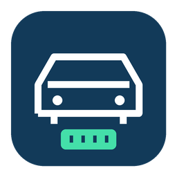

# OBD Connect



Receba no Home Assistant as leituras do ELM327 coletadas pelo aplicativo Android HR-V Connect. O celular salva localmente e envia lotes a cada minuto durante a coleta; se o receptor estiver inacessível, mantém a fila para novas tentativas.

[](https://my.home-assistant.io/redirect/hacs_repository/?owner=caiorasec&repository=obd-connect&category=integration)
[](https://github.com/caiorasec/obd-connect/actions/workflows/validate.yml)

## Requisitos

- Home Assistant **2026.11.0 ou superior**. A versão mínima corresponde à versão testada; versões anteriores não são anunciadas como compatíveis.
- Aplicativo Android HR-V Connect **0.4.0**, distribuído separadamente. O APK não está incluído neste repositório.
- Para o envio: URL HTTPS com certificado confiável, identificador do veículo e chave exclusiva do receptor.

## Instalar pelo Marketplace ou HACS

1. Use o botão acima para adicionar este repositório como **Integração**. Se preferir, adicione manualmente `https://github.com/caiorasec/obd-connect` nos repositórios personalizados, categoria Integração.
2. Instale **OBD Connect** e siga a indicação de reinício exibida pelo seu Home Assistant.
3. Em **Configurações → Dispositivos e serviços → Adicionar integração**, procure OBD Connect.
4. Informe nome do veículo, UUID exibido nos Ajustes do Android e a mesma chave do receptor nos dois lados.
5. No Android, salve a URL HTTPS base do Home Assistant e habilite o envio. Use **Enviar lote agora** para testar sem ligar o carro.

O repositório personalizado pode ser instalado diretamente; ele ainda não integra o catálogo público de busca. [Guia completo e instalação manual](docs/OBD_CONNECT_SETUP.md).

## O que aparece no Home Assistant

Um dispositivo por veículo, com nove sensores: RPM, velocidade, temperatura do motor, carga, acelerador, MAP, temperatura de admissão, tensão do módulo e tensão do adaptador (ATRV).

Leituras com mais de três minutos ficam indisponíveis. Dados atrasados continuam no histórico, sem substituir leituras mais recentes. GPS e simulações não são aceitos. A integração só recebe dados; não envia comandos ao carro.

## Rede, autenticação e histórico

O receptor usa chave exclusiva por veículo; não solicita senha Nabu Casa nem token administrativo do Home Assistant. O acesso remoto Nabu Casa pode fornecer a URL HTTPS, mas o fluxo por uma instalação residencial ainda precisa ser validado. Sem acesso ao servidor, o app conserva os dados.

Histórico e recibos de deduplicação ficam em `<config>/.storage/obd_connect/` e devem entrar no backup. Não há expurgo automático nessa versão. Eles não ficam dentro da pasta da integração e são preservados em atualizações do componente. O histórico não é retroinserido no Recorder com horários antigos.

A chave do receptor fica no config entry do Home Assistant e em preferências privadas do Android. Não compartilhe chave, banco ou diagnósticos brutos em issues públicas. Os exemplos e testes deste repositório são fictícios; não contêm coletas reais.

## Desenvolvimento e validação

```bash
docker compose --profile ha run --rm ha-tests
python3 tools/package_integration.py
```

Os testes usam Home Assistant real em Docker e arquivos temporários, sem acessar carro, telefone ou servidor residencial. O workflow inclui testes, Hassfest e HACS sem ignorar verificações. O pacote manual é gerado em `artifacts/`; o Marketplace instala o componente a partir do repositório/release, sem precisar de outro servidor receptor.

[Contrato e limites](docs/PHASE_3.md) · [Histórico de versões](CHANGELOG.md) · [Reportar problema](https://github.com/caiorasec/obd-connect/issues)

## Licença

[MIT](LICENSE). Titular: `caiorasec`.
